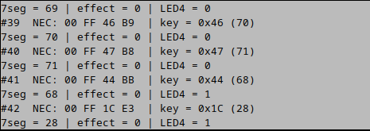

# BÁO CÁO BÀI THỰC HÀNH 1

| Họ và tên        | MSSV      |
| ---------------- | --------- |
| Nguyễn Gia Khánh | 202416803 |
| Đào Huy Hoàng    | 202400045 |

Nội dung và mã nguồn trong báo cáo thực hành này là do tôi và bạn cùng nhóm tự làm. Bất cứ nội dung nào tham khảo từ bên ngoài thì sẽ được nêu rõ nguồn gốc và tác giả.

**Nguồn tham khảo và công cụ hỗ trợ:** Các tài liệu do học phần cung cấp.

## 1. Bài 3.1 — LED đơn

Tám LED nối PD8–PD15 qua điện trở, cathode về GND. Bit 0–7 của `LED_Value` tương ứng PD8–PD15. Hàm `DisplayLEDs(mode)` chọn mẫu trong bảng rồi xuất từng bit ra GPIO:

```c
static const unsigned char effects[4][10] = {
  {0x00, 0x01, 0x02, 0x04, 0x08, 0x10, 0x20, 0x40, 0x80, 0x00},
  {0x00, 0x80, 0x40, 0x20, 0x10, 0x08, 0x04, 0x02, 0x01, 0x00},
  {0x00, 0xFF, 0x00},
  {0x00, 0x81, 0x42, 0x24, 0x18, 0x18, 0x24, 0x42, 0x81, 0x00}
};
```

Bốn hàng lần lượt là: chạy phải sang trái, chạy trái sang phải, nháy đồng thời tám LED, hai LED đối xứng vào/ra. Biến `step` chỉ vị trí trong chuỗi; hết chuỗi thì đặt `LED_CycleDone`. `LED_RunEffects()` đổi trạng thái mỗi 200 ms theo `HAL_GetTick()`, đếm đủ hai chu kỳ thì đổi mode, sau mode 4 quay về mode 1. Sắp PD15 bên trái, PD8 bên phải để đúng chiều.

## 2. Bài 3.2 — LED 7 thanh và B1

Hai digit cathode chung nối a–g, dp tới PE8–PE15; PG2 chọn đơn vị, PG3 chọn hàng chục qua transistor NPN. `SevenSeg_Init()` đặt số 25. `Set7SegDisplayValue()` lấy modulo 100, tách hai chữ số và tra bảng mã segment. Vì vậy 99 tăng tiếp sẽ về 00.

```c
static void Bai2_Process(void)
{
  uint32_t now = HAL_GetTick();
  if (Button_Pressed(now))
    Set7SegDisplayValue(Get7SegDisplayValue() + 1);
  RunLEDs(now, LAB_FAST_INTERVAL_MS);
}
```

`Button_Pressed()` chống dội 30 ms, chỉ trả về một sự kiện khi chuyển sang nhấn ổn định; giữ B1 không đếm thêm. Dãy tám LED đơn vẫn chạy mỗi 5 ms theo đề.

TIM6 ngắt mỗi 100 µs. Cứ 50 ngắt, `Run7SegDisplay()` tắt hai digit, đổi mẫu thanh rồi bật một digit, luân phiên mỗi 5 ms. Mỗi digit được làm mới mỗi 10 ms, tương ứng 100 Hz. Quét trong ngắt nên không phụ thuộc việc đọc B1 và chạy hiệu ứng ở main loop.

## 3. Bài 3.3 — Trả lời câu hỏi

### Câu 1. Tín hiệu trên PG5

OUT của HS0038 nối PG5, bình thường mức 1; nhận burst hồng ngoại thì xuống 0. HS0038 đã giải điều chế sóng mang 38 kHz. Trình tự mức logic là:

| Thành phần | LOW      | HIGH tiếp theo         |
| ---------- | -------- | ---------------------- |
| Leader     | 9 ms     | 4,5 ms                 |
| Bit 0      | 562,5 µs | 562,5 µs               |
| Bit 1      | 562,5 µs | 1687,5 µs              |
| Stop       | 562,5 µs | Trở về trạng thái nghỉ |

Sau leader là 32 bit. NEC chuẩn gửi địa chỉ, đảo địa chỉ, command, đảo command; mỗi byte LSB trước. Các thời gian trên là thông số lý thuyết trong tài liệu, không phải số đo oscilloscope. Khung OK `00 FF 1C E3` là kết quả thực hành trên PuTTY.

### Câu 2. EXTI5 dùng cạnh nào? Tại sao?

Dùng **Falling edge**, tức `GPIO_MODE_IT_FALLING`. Cạnh xuống là đầu một burst; khoảng giữa hai cạnh xuống bằng LOW cộng HIGH theo sau, cho phép nhận biết leader và bit. EXTI5 dùng handler chung `EXTI9_5_IRQHandler()`, qua HAL gọi `IrGetBitTime()`.

### Câu 3. Đo thời gian bit như thế nào?

Clock TIM6 là 90 MHz, PSC = 89, ARR = 99 nên tần số ngắt bằng `90 MHz / (90 × 100) = 10 kHz`, tức 100 µs/tick. `IR_Tick()` tăng `ir_ticks`; mỗi cạnh xuống PG5 đọc số tick rồi đặt về 0. Khoảng đo xấp xỉ số tick nhân 100 µs. Bộ đếm IR riêng, không bị B1 đặt lại.

### Câu 4. Phân biệt start, 0, 1 dựa vào đâu?

| Loại  | Khoảng giữa hai cạnh xuống | Cửa sổ trong code |
| ----- | -------------------------- | ----------------- |
| Start | 13,5 ms                    | 120–150 tick      |
| Bit 0 | 1,125 ms                   | 8–15 tick         |
| Bit 1 | 2,25 ms                    | 18–27 tick        |

Khoảng ngoài cửa sổ khi đang nhận làm hủy khung. Với khoảng dữ liệu đã hợp lệ, `IrDecode()` dùng ngưỡng lớn hơn 17 tick để nhận bit 1. Khung repeat NEC không tạo command mới. Lưu ý phần mô tả trang 5 ghi 1,25 ms cho bit 0; theo phụ lục và tổng `562,5 + 562,5 µs`, giá trị đúng là **1,125 ms**.

### Câu 5. Khi nào giải mã xong? Kết quả ở đâu?

`bit_time[0]` lưu leader, `[1..32]` lưu dữ liệu. Đủ 33 khoảng đo thì `command_ok = 1`; cạnh xuống đầu burst stop hoàn tất đo bit cuối. Đây là 32 bit dữ liệu cộng một khoảng đồng bộ, không phải 33 bit dữ liệu.

Main gọi `IR_ProcessFrame()`/`IrDecode()`, dựng khung LSB trước và kiểm tra command XOR byte đảo bằng `0xFF`. Cờ giữ bộ đệm không bị ghi đè đến khi giải mã xong. Kết quả nằm trong `irda_cmd[0..3]`; byte thứ ba `irda_cmd[2]` và `IR_LastKey` chứa mã nút. `IR_LastFrame` chứa cả khung, `IR_FrameCount` đếm khung hợp lệ. Ví dụ OK cho `IR_LastKey = 0x1C`, `IR_LastFrame = 0xE31CFF00`. Code chỉ kiểm tra cặp command/đảo command để chấp nhận cả địa chỉ NEC mở rộng.

## 4. Bài 4 — Remote điều khiển LED

`Bai4_Process()` nhận và giải mã khung, chuyển command cho `Bai4_HandleKey()` rồi tiếp tục chạy hiệu ứng không chặn:

```c
static void Bai4_Process(void)
{
  if (IR_ProcessFrame())
  {
    Bai4_HandleKey(IR_LastKey);
    IR_FrameReady();
  }
  LED_RunSelected(HAL_GetTick(), LAB_LED_INTERVAL_MS);
}
```

`Bai4_HandleKey()` gọi `Set7SegDisplayValue(key)` cho mọi command hợp lệ. Với OK, đảo `Remote_LED4State` và xuất lên PG14 (LED4 có sẵn trên kit). Nút 1–4 gọi `LED_SelectMode()` tương ứng. `LED_RunSelected()` giữ hiệu ứng tới khi chọn nút khác, bước 200 ms; B1 không đảo LED4 ở bài này.

| Nút | Khung đo thực tế | Giá trị hiển thị | Chức năng    |
| --- | ---------------- | ---------------- | ------------ |
| 1   | `00 FF 45 BA`    | 69               | Hiệu ứng 1   |
| 2   | `00 FF 46 B9`    | 70               | Hiệu ứng 2   |
| 3   | `00 FF 47 B8`    | 71               | Hiệu ứng 3   |
| 4   | `00 FF 44 BB`    | 68               | Hiệu ứng 4   |
| OK  | `00 FF 1C E3`    | 28               | Bật/tắt LED4 |



*Ảnh đo trước khi sửa ánh xạ nút*

PuTTY dùng Raw `127.0.0.1:9000`: script Python đọc kết quả qua ST-LINK tại `IR_FrameReady()`, chuyển sang TCP rồi tiếp tục MCU; không dùng UART như Hercules trong tài liệu gốc.

## how 2 run

```sh
# bai 3
cd Bai31_32
cmake --preset LED && cmake --build --preset LED       # 3.1
cmake --preset Debug && cmake --build --preset Debug   # 3.2

# bai 4
cd ../Bai4
cmake --preset Remote && cmake --build --preset Remote
python3 tools/ir_monitor.py --putty
```
