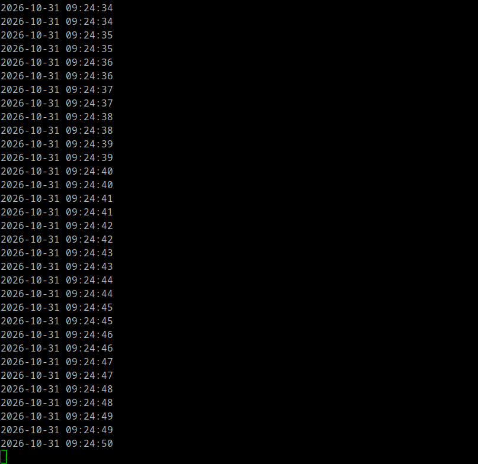
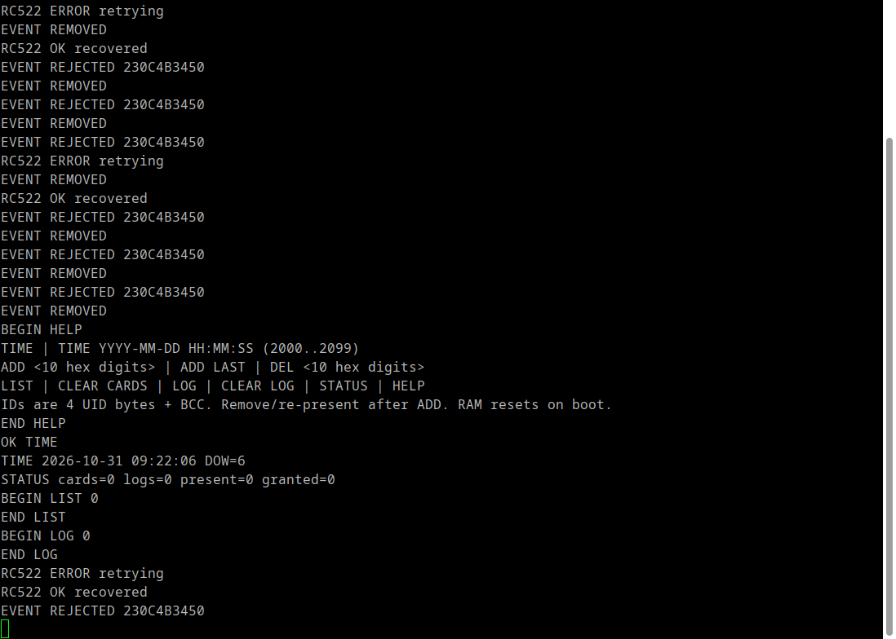

# Báo cáo thực hành 2 — Ghép nối nối tiếp

Sinh viên: ………………………  MSSV: ………………………  Nhóm: ………………………

Ngày kiểm chứng: 31/10/2026. Bản nháp dựa trên firmware và kết quả thật;
các mục chưa kiểm chứng được ghi rõ để bổ sung trước khi nộp.

## 1. Mục tiêu

Ghép nối STM32F429 Discovery với DS1307, EEPROM AT24C32, OLED SH1106 qua
I2C và RC522 qua SPI; xây dựng mô hình mở cửa theo mã thẻ, lưu log RAM,
quản lý thẻ và xem log từ PC bằng UART. Dùng **PuTTY thay Hercules** làm
terminal Serial; bộ lệnh firmware không đổi.

## 2. Trả lời phần tìm hiểu Tiny RTC

DS1307 giữ giờ, phút, giây, thứ, ngày, tháng, năm bằng thạch anh 32.768 kHz
và nguồn dự phòng. AT24C32 là EEPROM 32 Kbit = 4 KB. Hai IC cùng hoạt động
trên SDA/SCL vì có địa chỉ I2C khác nhau: DS1307 `0x68`; AT24C32 `0x50`
khi A0–A2 nối GND theo sơ đồ đề. Các chân cần dùng: VCC, GND, SCL, SDA.
Nguồn dự phòng duy trì thời gian nhưng nguồn chính vẫn cần cho giao tiếp.

DS1307 lưu thời gian dạng BCD; chương trình chuyển đổi BCD–thập phân
trong `SetTime()`/`GetTime()`, kiểm tra lịch và bit CH. Bus dùng 100 kHz
để phù hợp DS1307. AT24C32 không dùng để lưu log vì đề yêu cầu log RAM.

## 3. Phần cứng và cấu hình

Sơ đồ: [PDF hai trang](docs/so_do_lab2_day_du.pdf).

| Khối | Cấu hình |
| --- | --- |
| CPU | HSE 8 MHz, PLL tạo SYSCLK 180 MHz |
| I2C3 | PA8=SCL, PC9=SDA, 100 kHz |
| RC522 SPI4 | PE2=SCK, PE5=MISO, PE6=MOSI, PE4=SS, mode 0, 351.6 kHz |
| RC522 RST/VCC | Nguồn 3V của kit; GND chung |
| USART1 | PA9=TX, PA10=RX, 115200 8N1, no flow control |
| LED3 / LED4 | PG13 / PG14, tích hợp trên kit |
| Tiny RTC / OLED | VCC 5V / 3V theo đề; kiểm tra chuyển mức I2C theo sơ đồ |
| PC | PuTTY Serial qua VCP ST-LINK `/dev/ttyACM0` đã kiểm chứng |

## 4. Thiết kế chương trình

- `Core/Src/main.c`, `stm32f4xx_hal_msp.c`: clock và ngoại vi.
- `Libraries/rtc/ds1307.c`: kiểm tra lịch, chuyển BCD, đặt/đọc thời gian.
- `Libraries/oled/`: bộ đệm ảnh, font, hiển thị thời gian/trạng thái/mã thẻ.
- `Libraries/rfid/rc522.c`: giao tiếp SPI, WUPA, anticollision, SELECT,
  kiểm tra CRC/BCC, HALT; có timeout và giới hạn bộ đệm.
- `App/access.c`: danh sách tối đa 16 thẻ và vòng đệm 100 log RAM.
- `App/console.c`: phân tích lệnh UART, kiểm tra tham số, xuất log theo
  snapshot. UART nhận bằng ngắt, xử lý trong main.
- `App/diagnostics.c`: dò địa chỉ I2C, quan sát SPI, giải phóng bus bằng
  tối đa 9 xung SCL/STOP; khởi động RTC có CH=1 bằng giờ build cục bộ.

Mã thẻ 5 byte trong bài gồm 4 byte UID và 1 byte BCC. Thẻ đã đọc:
`23 0C 4B 34 50`, trong đó `23 XOR 0C XOR 4B XOR 34 = 50`.

## 5. Giao thức với PuTTY

Mỗi dòng chứa một lệnh, kết thúc bằng Enter. Phản hồi dùng CRLF.
Danh sách dài có cặp `BEGIN ...` / `END ...`; sự kiện tự phát có tiền tố
`EVENT`. Hướng dẫn mở và lưu log: [PuTTY](docs/putty.md).

| Lệnh | Chức năng |
| --- | --- |
| `TIME`, `TIME YYYY-MM-DD HH:MM:SS` | Đọc/đặt giờ |
| `ADD <10 ký tự hex>`, `ADD LAST` | Đăng ký thẻ |
| `DEL <mã>`, `LIST`, `CLEAR CARDS` | Quản lý danh sách |
| `LOG`, `CLEAR LOG` | Xem/xóa log |
| `STATUS`, `HELP` | Trạng thái và trợ giúp |

## 6. Kết quả đã kiểm chứng

### Mục 3.6 — DS1307 hiển thị trên PuTTY

Đã build preset `RTC`, nạp và verify thành công trên kit. PuTTY nhận
`READY LAB2 stage=6`, `RTC OK`, sau đó ngày giờ liên tục mỗi 500 ms.
Vì độ phân giải RTC là một giây, mỗi giá trị giây thường xuất hiện hai lần.
Ví dụ ghi nhận: `2026-10-31 09:24:33`, `09:24:34`, `09:24:35`.

[Dữ liệu UART thu thật của mục 3.6](docs/ket_qua_3_6.txt).

| Phép kiểm tra | Kết quả quan sát |
| --- | --- |
| Build và nạp qua ST-LINK | Thành công, verify Flash đạt |
| Dò I2C | OLED `0x3C`, EEPROM `0x50`, RTC `0x68` phản hồi |
| RTC | Đã xử lý CH=1; đọc thời gian hợp lệ, giây tăng |
| OLED | Người dùng xác nhận hiển thị thời gian |
| RFID | Đã đọc mã `230C4B3450`, nhận sự kiện Rejected/Removed |
| PuTTY Serial | Nhận phản hồi HELP, TIME, STATUS, LIST, LOG |
| Danh sách/log tại lần chụp | Đều trống, `cards=0 logs=0` |
| Kiểm thử trên host | RTC, access, console, RFID đạt với HAL giả lập và sanitizer |

Trong quá trình chạy có `RC522 ERROR retrying` rồi `RC522 OK recovered`.
Đầu đọc đã đọc được thẻ nhưng độ ổn định RF chưa đạt để kết luận toàn bộ
bài tổng hợp đã hoàn tất. Log trống trong ảnh là kết quả thực tế vì chưa
đăng ký thẻ ở thời điểm chụp.

## 7. Các minh chứng cần bổ sung trước khi nộp

### Cập nhật demo bài 3.9

Người dùng xác nhận chương trình chạy tốt. Log PuTTY thật đã ghi nhận
đăng ký thẻ, Welcome với thẻ được phép, Rejected với thẻ khác, xem và
xóa log. Xem [bản ghi phiên UART bài 3.9](docs/ket_qua_3_9_uart.txt).
Đã đọc được `BEGIN LOG 7` với thời gian và mã thẻ, gồm thẻ `23E4803473`
và `E3C48C349F`. Sau `CLEAR CARDS`, thẻ cũ bị Rejected; `ADD LAST`
đăng ký thẻ mới và các lần quẹt tiếp theo phát sinh Welcome.
Log vẫn có thông báo RC522 lỗi rồi phục hồi; chưa khẳng định đầu đọc
ổn định hoàn toàn hoặc giữ thẻ luôn chống trùng trong điều kiện này.

Các kết quả trong mục 6 và ảnh PuTTY ban đầu là ảnh chụp ở thời điểm
chưa đăng ký thẻ; phần cập nhật này ghi nhận kết quả demo sau đó.

- [x] Đăng ký thẻ bằng UART và nhận `OK ADD`.
- [x] Nhận sự kiện `EVENT WELCOME` và `EVENT REJECTED` thực tế.
- [x] Xem 7 log mở cửa có ngày giờ và mã thẻ.
- [x] Xóa danh sách thẻ, xác nhận thẻ cũ bị từ chối.
- [x] Xóa log bằng `CLEAR LOG`, nhận `OK CLEAR LOG`.

Phần ảnh và các quan sát chi tiết còn cần bổ sung:

- [ ] Ảnh toàn bộ mạch thực tế.
- [ ] `ADD 230C4B3450` và `LIST` chứng minh đăng ký thẻ.
- [ ] Quẹt lại: OLED Welcome, LED4 sáng, UART EVENT WELCOME.
- [ ] LOG hiển thị thời gian và mã thẻ của lần mở cửa.
- [ ] Giữ thẻ không tạo log trùng trong điều kiện RF ổn định.
- [ ] DEL rồi quẹt lại bị Rejected.
- [ ] Quan sát LED3/LED4 thực tế khi đưa/rút thẻ.

Không đánh dấu các mục này chỉ dựa vào kiểm thử giả lập.

## 8. Nhận xét

Bus I2C cho phép nhiều slave cùng hai đường tín hiệu nhờ địa chỉ riêng;
SPI dùng đường SS để chọn RC522. RTC giúp log có thời gian thực độc lập
vòng lặp STM32. PuTTY thay Hercules vì cùng gửi/nhận chuỗi byte UART.
Khó khăn thực tế gồm bus I2C bị bận, RTC dừng ở CH=1 và RFID lỗi gián đoạn.
Phần mềm đã bổ sung phục hồi bus, kiểm tra dữ liệu và thông báo lỗi để
quan sát được các trường hợp này.
