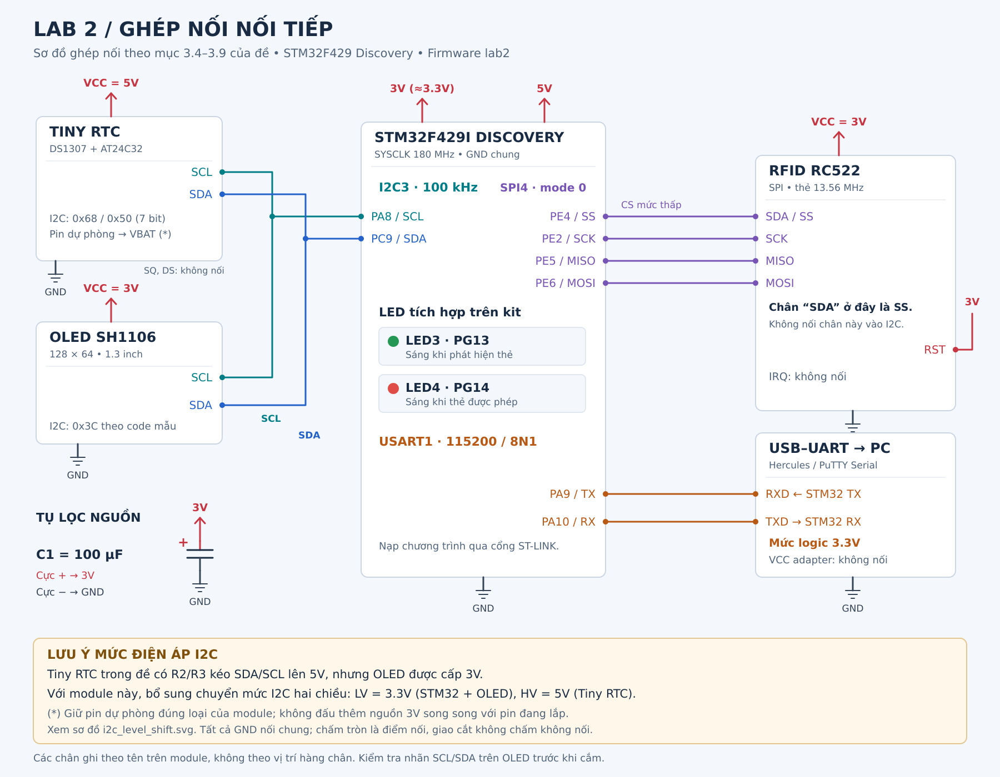

# Lab 2 — Ghép nối nối tiếp, STM32F429 Discovery

**Dùng PuTTY:** chạy `python3 tools/putty_serial.py` từ thư mục `lab2`.
Đã kiểm chứng Serial trực tiếp qua VCP ST-LINK `/dev/ttyACM0`, 115200 8N1.
Xem [hướng dẫn PuTTY và lưu log](docs/putty.md) và
[bản nháp báo cáo theo kết quả thật](BAO_CAO_LAB2.md).

Firmware cho mục 3.6–3.9 trong `Lab 2/Thuc hanh 2.pdf` (Ver. 2025).
CPU 180 MHz; I2C3 100 kHz; SPI4 mode 0, 351.6 kHz; USART1 115200 8N1.

Kiểm tra trên kit ngày 31/10/2026: đã phục hồi I2C bị bận bằng tối đa
9 xung SCL và STOP; OLED khởi tạo thành công, người dùng xác nhận hiện giờ;
DS1307 đọc giờ hợp lệ, giây tăng. EEPROM ACK ở 0x50 (chưa thử ghi).
Lần kiểm tra tiếp theo: RC522 đã khởi tạo, xác minh cấu hình thành công
và đọc được mã thẻ `230C4B3450` (UID `23 0C 4B 34`, BCC `50`). Khi rút
thẻ, trạng thái present trở về 0. Danh sách cho phép hiện trống nên thẻ
chưa được mở cửa; dùng `ADD 230C4B3450` qua UART rồi quẹt lại để thử.
Cập nhật demo 3.9: đã nhận `OK ADD`, `EVENT WELCOME` và Rejected cho
thẻ khác; đã xem 7 log có ngày giờ/mã thẻ và xóa log qua PuTTY. Người
dùng xác nhận chạy tốt. Xem `docs/ket_qua_3_9_uart.txt`. Vẫn quan sát
thông báo RC522 lỗi rồi phục hồi, chưa kết luận RF ổn định hoàn toàn.
`lab_diag` và các biến `rc522_*` cung cấp số liệu qua debugger.
Phép dò chạy mỗi 5 giây; OLED được thử khởi tạo lại khi xuất hiện trên bus.
Khi DS1307 có CH=1 (đồng hồ đang dừng), bản chẩn đoán đặt giờ build cục bộ
một lần để khởi động. Dùng lệnh TIME để chỉnh chính xác; không ghi lại khi
đồng hồ đang chạy.

## Yêu cầu và phần đã làm

| Mục đề | Yêu cầu | Mã nguồn / chế độ |
| --- | --- | --- |
| 3.1–3.5 | Tìm hiểu thiết bị, nối mạch, cấu hình ngoại vi | Sơ đồ bên dưới; `Core/Src/main.c`, `stm32f4xx_hal_msp.c` |
| 3.6 | Tách SetTime/GetTime; đọc giờ qua UART | `Libraries/rtc/ds1307.c`; preset `RTC` |
| 3.7 | Hiển thị thời gian đồng thời lên OLED và PuTTY (UART mỗi 500 ms) | `App/lab_app.c`; preset `OLED` |
| 3.8 | Hiển thị mã thẻ 5 byte | `Libraries/rfid/rc522.c`; preset `RFID` |
| 3.9 | LED3 báo có thẻ, LED4 mở cửa, Welcome/Rejected, 100 log RAM, lệnh UART | `App/access.c`, `App/console.c`; preset `Access` |

DS1307 và AT24C32 dùng chung bus vì có địa chỉ khác nhau: `0x68` và
`0x50` (A0–A2 nối GND theo sơ đồ đề). AT24C32 là EEPROM 4 KB; đề tổng hợp
yêu cầu log trong RAM nên firmware không ghi EEPROM. DS18B20 không dùng.

## Sơ đồ và nối mạch



Bản vector: [SVG](docs/so_do_lab2.svg); bản in đủ hai trang:
[PDF](docs/so_do_lab2_day_du.pdf).
Xem thêm [tách mức điện áp I2C](docs/i2c_level_shift.svg).

| Tín hiệu / thiết bị | Kết nối |
| --- | --- |
| Tiny RTC VCC / GND | 5V / GND chung |
| OLED VCC / GND | Chân nguồn 3V của kit / GND |
| Tiny RTC SCL và OLED SCL | PA8 — I2C3_SCL, lưu ý mức điện áp bên dưới |
| Tiny RTC SDA và OLED SDA | PC9 — I2C3_SDA, lưu ý mức điện áp bên dưới |
| RC522 SDA/SS | PE4, GPIO output, chọn chip mức thấp; **đây là SS của SPI** |
| RC522 SCK / MISO / MOSI | PE2 / PE5 / PE6 |
| RC522 VCC và RST | Nguồn 3V của kit |
| RC522 GND / IRQ | GND / không nối |
| USB–UART RXD / TXD | PA9 (STM32 TX) / PA10 (STM32 RX) |
| USB–UART GND | GND chung; dùng mức logic UART 3.3V, không nối VCC adapter |
| Tụ 100 µF | Cực + vào 3V, cực − vào GND |
| LED3 / LED4 | PG13 / PG14, đã có trên Discovery |

**Mức điện áp I2C:** sơ đồ Tiny RTC trong đề có R2/R3 kéo SDA/SCL lên
VCC=5V, trong khi OLED được cấp 3V. Vì vậy sơ đồ ghép nối trực tiếp trong
đề chưa giải quyết việc tương thích điện áp giữa các module. Với Tiny RTC
đúng sơ đồ này, dùng bộ chuyển mức **I2C hai chiều kiểu open-drain**:
phía LV=3.3V nối STM32 + OLED, phía HV=5V nối Tiny RTC, chung GND, có điện
trở kéo lên ở cả hai phía. Không dùng cầu chia áp cho SDA hai chiều.
Sơ đồ bổ sung minh họa cách nối; firmware và địa chỉ không thay đổi.
Không đơn giản chuyển toàn bộ pull-up về 3.3V nếu vẫn dùng AT24C32 ở 5V:
datasheet kèm đề quy định VIH tối thiểu bằng 0.7×VCC.

**BAT:** hai bản đề khác nhau ở dòng BAT→3V. Giữ pin dự phòng đúng loại
theo module thực tế để RTC chạy khi mất nguồn; không nối thêm 3V song song
với pin đang lắp. Mạch Tiny RTC trong đề có đường sạc pin, cần đối chiếu
loại pin và module trước khi cấp nguồn. DS1307 cần nguồn chính để giao tiếp
I2C; nguồn pin chỉ duy trì đồng hồ. Kiểm tra thứ tự SCL/SDA in trên OLED.

## Build

Project dùng CMSIS/HAL đã có trong `../lab1/Drivers` và các file HAL I2C/SPI
v1.8.3 bổ sung tại `Drivers/`. Giữ cấu trúc thư mục `lab1` và `lab2` cạnh nhau.
Không cần tải thư viện khi build.

```sh
cd 20261_embedsys/lab2
cmake --preset Access
cmake --build --preset Access
```

Thay `Access` bằng `RTC`, `OLED`, `RFID` để chạy từng mục. Kết quả:
`build/<preset>/Lab2_20261.elf`, `.hex`, `.bin`.
Nạp `.hex` bằng STM32CubeProgrammer qua ST-LINK rồi reset/run.
Đã build cả bốn chế độ; tình trạng kiểm chứng trên kit ghi ở đầu tài liệu.

Nếu dùng project tạo bằng CubeIDE: dùng đúng clock/pin ở bảng trên, bật
ngắt USART1; thêm `App` và `Libraries` vào đường dẫn include/source. Dùng
`LabApp_Init()` sau khởi tạo ngoại vi, gọi `LabApp_Process()` trong vòng lặp.
Giữ duy nhất một bộ handle `hi2c3/hspi4/huart1` và handler
`USART1_IRQHandler()` gọi `HAL_UART_IRQHandler(&huart1)`.
Các callback UART trong `lab_app.c` phải được giữ. Project CMake này không
có `.ioc`; có thể mở trực tiếp với CMake Tools trên VS Code.

## Chạy bài tổng hợp

1. Với kit hiện tại, cắm cáp ST-LINK và chạy `python3 tools/putty_serial.py`.
   Đã kiểm chứng VCP ST-LINK nối được với UART firmware; không cần thêm adapter.
   Nếu dùng USB–UART ngoài, nối như bảng. Mở Serial ở **115200,
   8 data bits, no parity, 1 stop bit, no flow control**. Đây là UART vật lý,
   khác monitor Raw TCP qua debugger của Lab 1.
2. Sau reset sẽ có `READY LAB2 stage=9`. Gửi mỗi lệnh kết thúc bằng CR,
   LF hoặc CRLF; trong Hercules thêm ký tự kết thúc dòng vào ô gửi.
3. Đặt thời gian hiện tại **một lần**, ví dụ `TIME 2026-10-31 08:30:00`.
   Không ghi lại mốc cố định sau mỗi lần bật kit.
4. Đưa thẻ vào đầu đọc. Ban đầu danh sách trống nên hiện `Rejected`;
   UART in `EVENT REJECTED <mã>`. Khi vẫn giữ thẻ, gửi `ADD LAST`.
5. Rút thẻ ít nhất khoảng 0.5 giây rồi đưa lại: LED3 và LED4 sáng,
   OLED hiện `Welcome`; gửi `LOG` để xem bản ghi.
6. Giữ thẻ: không phát sinh log trùng. Rút thẻ: LED3/LED4 tắt sau khoảng
   300 ms phát hiện vắng thẻ cộng thời gian xử lý I/O.
7. Thử thẻ khác chưa đăng ký: LED3 sáng, LED4 tắt, OLED `Rejected`, không
   thêm log mở cửa. Gửi `DEL <mã>` để thu hồi thẻ.

## Giao thức UART tự thiết kế

Lệnh dùng chữ hoa, một dấu cách giữa các thành phần; hex mã thẻ nhận cả
chữ hoa và thường. Tối đa 95 ký tự/dòng. Gửi một lệnh, đợi phản hồi rồi
gửi tiếp; với `LOG`, `LIST`, `HELP`, đợi dòng `END ...`. Các sự kiện
`EVENT ...` có thể xen giữa dữ liệu trả về.

| Lệnh | Ý nghĩa |
| --- | --- |
| `HELP` | Danh sách lệnh |
| `TIME` | Đọc giờ, thứ; thứ Hai=1 ... Chủ nhật=7 |
| `TIME 2026-10-31 08:30:00` | Đặt ngày giờ; giới hạn 2000–2099, tự tính thứ |
| `ADD 1122334444` | Thêm mã thẻ 5 byte; đây là mã ví dụ, thay bằng mã đọc được |
| `ADD LAST` | Thêm thẻ đang được đầu đọc phát hiện |
| `DEL 1122334444` | Xóa mã khỏi danh sách; tắt quyền mở cửa hiện tại nếu trùng |
| `LIST` | Liệt kê các mã được phép |
| `CLEAR CARDS` | Xóa danh sách thẻ và tắt LED4 |
| `LOG` | In snapshot các log, cũ nhất trước |
| `CLEAR LOG` | Xóa log RAM |
| `STATUS` | Số thẻ, số log, trạng thái hiện diện và quyền mở cửa |

Ví dụ:

```text
BEGIN LOG 1
LOG 1 2026-10-31 08:30:10 1122334444
END LOG
```

## Các quyết định triển khai

- Danh sách tối đa 16 thẻ; khởi động trống để đăng ký thẻ thật. Có thể đặt
  trước bằng cách gọi `Access_Add()` trong `LabApp_Init()` sau `Access_Init()`.
  Danh sách và log đều mất khi reset, vì lưu RAM.
- Log là vòng đệm 100 phần tử: khi đầy, bản ghi mới thay bản ghi cũ nhất.
  Chỉ lần quẹt hợp lệ mới ghi log; không ghi lại khi giữ nguyên thẻ.
- LED4 sáng trong lúc thẻ hợp lệ còn hiện diện; tắt khi rút hoặc bị thu hồi.
  Thẻ mới thêm cần rút/đưa lại để mở cửa. Đây là cách cụ thể hóa phần thời
  gian bật LED4 mà đề không quy định rõ.
- RTC dùng BCD, kiểm tra lịch/thứ/bit CH, hỗ trợ đọc cả 12h và 24h,
  ghi theo 24h. Khi đọc RTC lỗi lúc mở cửa, log vẫn giữ mã thẻ nhưng ghi
  `RTC_INVALID`, không gán thời gian giả. Sửa kết nối hoặc đặt `TIME` rồi thử lại.
- Với mẫu thẻ của bài, “5 byte mã thẻ” là **4 byte UID + 1 byte BCC (XOR)**.
  Driver này chỉ phục vụ thẻ UID 4 byte, mỗi lần một thẻ. Thẻ UID 7/10 byte
  bị báo `UID not supported`; không lấy nhầm phần đầu để cấp quyền.
- Driver RC522 có timeout, kiểm tra độ dài FIFO, BCC và CRC của SAK;
  dùng WUPA/SELECT/HALT để đọc lại thẻ đang giữ tại đầu đọc.
- OLED dùng font/mã mẫu trong đề, sửa thời gian chờ truyền trang cho bus
  100 kHz và offset cột mặc định=2. Nếu hình bị lệch, đối chiếu loại panel,
  chỉnh `SH1106_COLUMN_OFFSET` trong `SH1106.h`; địa chỉ mặc định `0x3C`.
- UART nhận bằng ngắt và hàng đợi 512 byte, xử lý lệnh tại main. Dòng quá
  dài hoặc lỗi/tràn UART bị loại bỏ để không thực thi lệnh bị cắt cụt.
  Khi tràn UART, gửi một newline rồi gửi lại toàn bộ lệnh.

## Kiểm tra phần mềm

```sh
bash Tests/run.sh
```

Test dùng HAL giả lập, AddressSanitizer và UndefinedBehaviorSanitizer:
BCD, 12/24h, năm nhuận, CH, I2C lỗi; thêm/xóa thẻ; giữ/rút/đổi thẻ; vòng
đệm 100 log; tick tràn; parser UART và snapshot log; trình tự RC522,
CRC/BCC, FIFO sai độ dài, SPI lỗi và timeout. Test không xác nhận điện áp,
dây nối, độ nhạy đầu đọc hoặc chất lượng hiển thị thật.

## Nguồn thư viện

- CMSIS/HAL nền và startup: project Lab 1 có sẵn.
- HAL I2C/SPI bổ sung: [STMicroelectronics v1.8.3](https://github.com/STMicroelectronics/stm32f4xx-hal-driver/tree/v1.8.3), giữ license tại `Drivers/STM32F4xx_HAL_Driver/LICENSE.md`.
- OLED/font và tên thanh ghi RC522: `Lab 2/Sample code`, giữ thông tin tác
  giả và GPL trong các file; phần giao tiếp RC522 được viết riêng cho bài.
- Thanh ghi và timeout RC522 đối chiếu [datasheet NXP MFRC522](https://www.nxp.com/docs/en/data-sheet/MFRC522.pdf).
- RTC/EEPROM đối chiếu `Lab 2/DS1307.pdf`, `Lab 2/AT24C32.pdf`.
