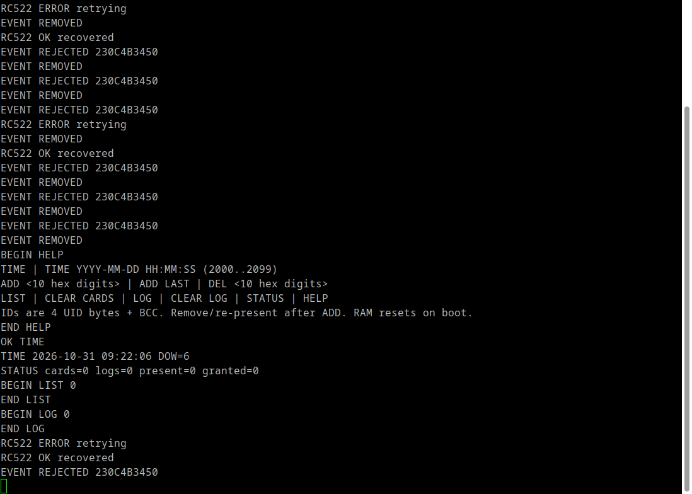

# Dùng PuTTY thay Hercules — Lab 2

## Cấu hình đã kiểm chứng trên kit hiện tại

| Thuộc tính | Giá trị |
| --- | --- |
| Kiểu kết nối | **Serial** |
| Cổng Linux | `/dev/ttyACM0` |
| Cổng ổn định theo thiết bị | `/dev/serial/by-id/usb-STMicroelectronics_STM32_STLink_0670FF535557888367251519-if02` |
| Speed | **115200** |
| Data bits / Stop bits | **8 / 1** |
| Parity / Flow control | **None / None** |
| Local echo / Local line editing | Force on / Force on |
| Firmware | Preset `Access`, USART1 PA9/PA10 |

Kit đang dùng có ST-LINK/V2.1 với Virtual COM Port. Đã gửi lệnh và nhận
đúng phản hồi qua cáp USB ST-LINK hiện tại; không cần thêm USB–UART cho
kit này. Đây là kết nối Serial thật, không dùng bridge TCP/debugger của
Lab 1. Nếu đổi sang board khác, phải kiểm chứng lại việc nối VCP với UART.

## Mở phiên và lưu log

Từ gốc workspace:

```sh
cd 20261_embedsys/lab2
python3 tools/putty_serial.py
```

Script tự tìm VCP ST-LINK, tạo session `Lab2-Serial` trong
`build/putty/sessions/`, mở PuTTY và lưu đầu ra vào
`logs/putty_YYYYMMDD_HHMMSS.log`. Không thay đổi cấu hình PuTTY cá nhân.
Nếu có nhiều kit, chọn rõ cổng:

```sh
python3 tools/putty_serial.py --port /dev/ttyACM0
```

Chỉ mở một cửa sổ PuTTY cho cùng cổng. Khi muốn chạy lại
`tools/serial_check.py`, đóng PuTTY trước để hai chương trình không tranh
đọc dữ liệu.

Trong PuTTY Configuration có thể cấu hình bằng tay: Session → Serial;
Serial line `/dev/ttyACM0`, Speed `115200`; Connection → Serial đặt 8/1,
Parity None, Flow control None. Terminal đặt local echo/line editing
Force on. Session → Logging chọn All session output và tên file.
Gõ một lệnh rồi Enter. Chờ `END ...` khi xem `LOG`, `LIST`, `HELP`.

## Các bước lấy minh chứng báo cáo

1. Gõ `HELP`, `TIME`, `STATUS` để chụp giao thức, ngày giờ và trạng thái.
2. Khi chưa đăng ký, đưa thẻ vào: chụp `EVENT REJECTED 230C4B3450`, OLED
   `Rejected`, LED3 sáng và LED4 tắt.
3. Gửi `ADD 230C4B3450`, đợi `OK ADD ...`; gửi `LIST` để kiểm tra.
4. Rút thẻ, đợi khoảng 0.5 giây, đưa lại: chụp `EVENT WELCOME ...`,
   OLED `Welcome` và LED4 sáng. Kết quả này cần được kiểm chứng thực tế.
5. Gửi `LOG`, chụp các dòng `LOG <số> <ngày giờ> <mã thẻ>` và `END LOG`.
6. Giữ nguyên thẻ để xem có phát sinh log trùng hay không. Kiểm tra cả
   sự kiện `RC522 ERROR retrying`; hiện đầu đọc còn lỗi gián đoạn nên
   chưa thể kết luận hành vi giữ thẻ ổn định chỉ từ kiểm thử phần mềm.
7. Gửi `DEL 230C4B3450`, rút/đưa lại để kiểm chứng thu hồi quyền.

Mã trên là thẻ đã đọc được thật trên kit; nếu đổi thẻ, thay bằng mã trong
`EVENT ...`. Không reset giữa các bước vì danh sách thẻ và log nằm trên RAM.

## Minh chứng đã thu



Ảnh là cửa sổ PuTTY đang nhận trực tiếp từ VCP. Trong lần chụp này,
các lệnh kiểm chứng được một tiến trình gửi qua cùng UART, PuTTY là
chương trình duy nhất đọc và hiển thị phản hồi. Không dựng đầu ra giả.

Đã quan sát `BEGIN/END HELP`, `OK TIME`, thời gian đọc lại, `STATUS`,
`BEGIN/END LIST`, `BEGIN/END LOG`, và `EVENT REJECTED 230C4B3450`.
`cards=0`, `logs=0` tại lần chụp. Chưa thu minh chứng Welcome/log mở cửa.
Các dòng `RC522 ERROR retrying` và `RC522 OK recovered` thể hiện lỗi
gián đoạn còn tồn tại, cần giữ trong phần nhận xét kết quả.

Log đầy đủ của phiên nằm trong `logs/`; ảnh và phần trích UART được lưu
trong tài liệu project. Không chỉnh nội dung log để biến trường hợp chưa
đạt thành kết quả thành công.
